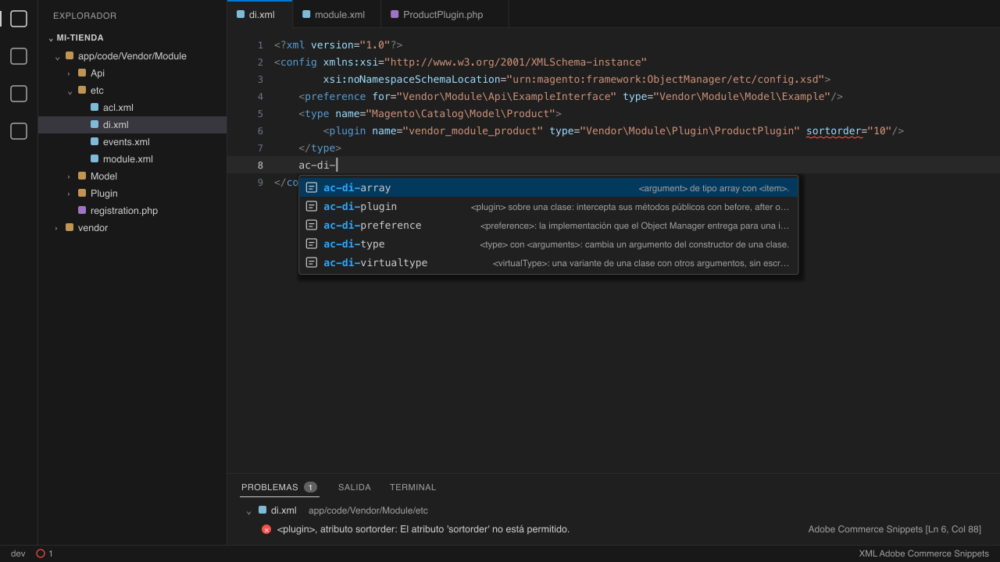

# Adobe Commerce Snippets

**Snippets para Adobe Commerce y validación en vivo de los XML contra los XSD de tu propio proyecto.**

Extensión de VS Code para el desarrollo PHP de Adobe Commerce (Magento Open Source y Adobe Commerce): valida mientras
escribes cada `di.xml`, `events.xml`, `db_schema.xml`, layout y demás XML que declare un esquema `urn:magento:...`,
contra los XSD de la versión exacta que tu tienda tiene instalada, y trae snippets de XML, PHP, templates, RequireJS
y GraphQL escritos a partir de la documentación oficial.

[](./LICENSE)



Versión del código: **0.1.0**, según [package.json](package.json). Requiere **VS Code >= 1.90.0**.

---

## Por qué otra extensión

Hay extensiones de snippets para Adobe Commerce en el Marketplace, la mayoría sin cambios desde hace años, y hay
herramientas que generan archivos y navegan entre clases. **Ninguna valida el XML en vivo contra los XSD.** Hasta
ahora, eso pedía generar un catálogo de URN con `bin/magento dev:urn-catalog:generate` y otra extensión de XML con su
propio servidor de lenguaje.

Esta extensión lo hace sola:

- **Lee los XSD del proyecto abierto**, en `vendor/` o en `app/code/`, resolviendo la URN del
  `xsi:noNamespaceSchemaLocation`. Valida contra la versión que tu tienda usa, no contra una copia vieja.
- **Resuelve también los `xs:include` y `xs:redefine` de los XSD**, que usan URN igual que los XML.
- **Sin falsos positivos**: si no encuentra un XSD, no marca nada. Se prueba contra los más de 2.400 XML del núcleo
  de la plataforma, sin un solo error.
- **Sin binarios ni Java**: usa libxml2 compilado en WebAssembly, el mismo motor de validación que usa la plataforma,
  y funciona igual en macOS, Linux y Windows.
- **Snippets con fuente**: cada uno cita la página de la documentación de la que salió, y los de XML se validan en
  los tests contra los XSD oficiales.

No genera archivos con comandos ni navega entre clases, layouts o ACL. Para eso ya existen otras herramientas, y esta
convive con ellas.

## Instalación

Desde el VS Code Marketplace: busca **«Adobe Commerce Snippets»**, o desde Quick Open (`Cmd/Ctrl + P`):

```
ext install commenteme.adobe-commerce-snippets
```

Desde el terminal:

```bash
code --install-extension commenteme.adobe-commerce-snippets
```

## Validación de XML

Abre cualquier XML de un módulo o de un tema. Si declara un esquema `urn:magento:...`, los errores aparecen
subrayados en el atributo o la etiqueta exactos, en español: atributo que no existe, atributo obligatorio que falta,
elemento fuera de lugar, valor fuera de la lista (`onDelete="CASCATA"`), número inválido o XML mal formado. Se valida
al abrir, al guardar y mientras escribes.

### Cómo encuentra el XSD

La URN dice de qué componente es el XSD, y el `registration.php` de cada componente dice dónde está:

| URN | Se busca en |
| :--- | :--- |
| `urn:magento:module:Vendor_Module:etc/archivo.xsd` | La carpeta del módulo registrado como `Vendor_Module` |
| `urn:magento:framework:Ruta/etc/archivo.xsd` | La biblioteca registrada como `magento/framework` |
| `urn:magento:framework-<nombre>:etc/archivo.xsd` | La biblioteca registrada como `magento/framework-<nombre>` |

Los `registration.php` se leen de `vendor/composer/autoload_files.php` (todo paquete instalado por Composer está ahí),
de `app/code/<Vendor>/<Module>/` y, en una instalación desde el repositorio, de `lib/internal/Magento/Framework/`. La
raíz del proyecto es la carpeta más cercana al archivo con `vendor/composer/autoload_files.php` o `app/etc/di.xml`.

Por qué no viene ningún XSD en la extensión: los XSD de la plataforma tienen licencia OSL-3.0 y esta extensión es MIT.
Leerlos de tu proyecto, además, garantiza que la validación corresponde a la versión instalada. Si un XSD no se
encuentra (el módulo no está instalado, todavía no corriste `composer install`), el XML queda sin diagnóstico y el
motivo aparece en **Salida > Adobe Commerce Snippets**.

### Configuración

```json
"adobeCommerceSnippets.validarXml": false
```

apaga la validación.

## Snippets

Todos los prefijos empiezan con `ac-`. Escribe `ac-` y el editor muestra la lista.

### XML de módulo

| Prefijo | Qué inserta |
| :--- | :--- |
| `ac-module`, `ac-module-sequence` | `etc/module.xml`, el orden de carga con `<sequence>` |
| `ac-di` | `etc/di.xml` vacío |
| `ac-di-preference` | `<preference>` |
| `ac-di-type`, `ac-di-array` | `<type>` con `<arguments>`, argumento de tipo array |
| `ac-di-virtualtype` | `<virtualType>` |
| `ac-di-plugin` | `<type>` con `<plugin>` |
| `ac-events`, `ac-event` | `etc/events.xml`, `<event>` con `<observer>` |
| `ac-routes`, `ac-routes-admin` | `routes.xml` del frontend y del Admin |
| `ac-webapi`, `ac-webapi-route` | `etc/webapi.xml`, una `<route>` con su recurso |
| `ac-acl` | `etc/acl.xml` |
| `ac-system`, `ac-system-field` | `etc/adminhtml/system.xml`, un `<field>` |
| `ac-config` | `etc/config.xml` con valores por defecto |
| `ac-crontab`, `ac-cron-job` | `etc/crontab.xml`, un `<group>` con `<job>` |
| `ac-communication` | `etc/communication.xml` |
| `ac-queue-consumer`, `ac-queue-publisher`, `ac-queue-topology` | Los `queue_*.xml` de la cola de mensajes |
| `ac-indexer`, `ac-mview` | `etc/indexer.xml`, `etc/mview.xml` |

### `db_schema.xml`

| Prefijo | Qué inserta |
| :--- | :--- |
| `ac-db-schema`, `ac-db-table` | El archivo con una tabla, una `<table>` |
| `ac-db-int`, `ac-db-varchar`, `ac-db-text`, `ac-db-decimal`, `ac-db-timestamp`, `ac-db-boolean` | Una `<column>` de cada tipo |
| `ac-db-index`, `ac-db-unique`, `ac-db-foreign` | Índice, clave única y clave foránea |

### Layout

| Prefijo | Qué inserta |
| :--- | :--- |
| `ac-layout` | Archivo de layout con `<body>` |
| `ac-layout-referenceblock`, `ac-layout-referencecontainer` | `<referenceBlock>`, `<referenceContainer>` |
| `ac-layout-block` | `<block>` con template y ViewModel |
| `ac-layout-container` | `<container>` |
| `ac-layout-move`, `ac-layout-remove` | `<move>`, quitar un bloque o contenedor |

### PHP

| Prefijo | Qué inserta |
| :--- | :--- |
| `ac-registration` | `registration.php` |
| `ac-plugin`, `ac-plugin-before`, `ac-plugin-after`, `ac-plugin-around` | Clase de plugin y cada tipo de método |
| `ac-observer` | Observer |
| `ac-controller`, `ac-controller-json`, `ac-controller-admin` | Controller GET del frontend, POST con JSON y del Admin con `ADMIN_RESOURCE` |
| `ac-viewmodel` | ViewModel con `ArgumentInterface` |
| `ac-data-patch`, `ac-schema-patch` | Data patch y schema patch |
| `ac-cron` | Clase de un cron job |
| `ac-consumer` | Consumer de la cola de mensajes |
| `ac-resolver` | Resolver de GraphQL |
| `ac-service-contract` | Interfaz de repositorio en `Api/` |

### Templates `.phtml`

| Prefijo | Qué inserta |
| :--- | :--- |
| `ac-phtml` | Cabecera con `$block`, `$escaper` y el ViewModel |
| `ac-esc-html`, `ac-esc-html-tags` | `escapeHtml`, con etiquetas permitidas |
| `ac-esc-attr` | `escapeHtmlAttr` |
| `ac-esc-url` | `escapeUrl` |
| `ac-esc-js` | `escapeJs` |

### RequireJS y GraphQL

| Prefijo | Qué inserta |
| :--- | :--- |
| `ac-requirejs-config` | `requirejs-config.js` con `map`, `paths` y `mixins` |
| `ac-requirejs-map`, `ac-requirejs-paths`, `ac-requirejs-mixins` | Cada sección por separado |
| `ac-mixin-component`, `ac-mixin-widget`, `ac-mixin-function` | Mixin de componente UI, de widget jQuery y de función |
| `ac-graphql-query`, `ac-graphql-mutation`, `ac-graphql-extend` | Query, mutation y campo nuevo en un tipo existente de `schema.graphqls` |

## Junto con otras extensiones

No colorea la sintaxis. Asocia `.phtml` al lenguaje `php` y `.graphqls` al lenguaje `graphql` para los snippets, y
convive con cualquier extensión que traiga la gramática de PHP, XML o GraphQL.

## Desarrollo

```bash
npm install
npm run check          # regenera los snippets, falla si cambiaron, y corre los tests
ADOBE_COMMERCE_PROJETO=/ruta/del/proyecto node --test   # valida todos los XML de un proyecto real
```

Los tests bajan los XSD de `magento/magento2` (2.4.9) a una carpeta temporal, fuera del repositorio, para validar
cada snippet y los XML del núcleo. Nada de eso entra en el repositorio ni en el paquete. Sin red, esos tests se
saltan. `npm run xsd-teste` hace la descarga a mano.

Ramas: el trabajo sale de `dev` y llega por pull request; `dev → qa → main` por merge de la rama entera, y el commit
de `main` lleva tag anotado de versión. `./scripts/instalar-hooks.sh` activa los hooks que cobran lo mismo en local.

## Licencia

MIT, ver [LICENSE](LICENSE). Los snippets se escribieron a partir de la documentación de Adobe Commerce (Apache-2.0 y
MIT), y la validación usa libxml2-wasm (MIT): ver [NOTICE](NOTICE).

---

_Hecho con amor y café por [commente.me](https://commente.me)_
